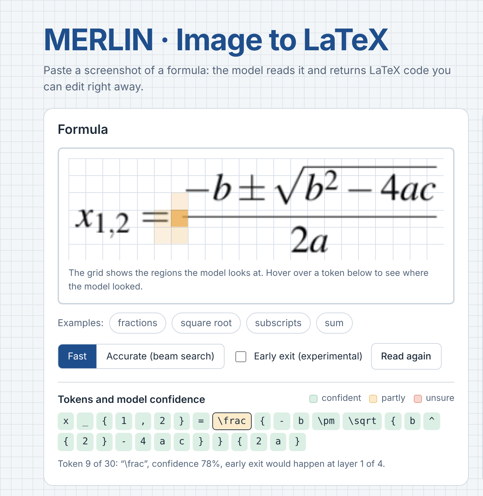

<div align="center">

# MERLIN

**M**ath **E**xpression **R**ecognition with **L**earned **IN**variance

*Turn an image of a mathematical formula into LaTeX code, even when the font is one the model has never seen.*




</div>

---

MERLIN is a deep-learning model and a web application for **image-to-LaTeX conversion**. You paste a screenshot
of a formula and get back LaTeX source you can edit, preview and copy, together with a per-token confidence score
and the model's attention map.

It was built as a master's thesis project at the Faculty of Sciences and Mathematics, University of Niš:
*“Application of deep learning for converting mathematical formulas into equivalent LaTeX code and integration
into a client–server environment”* (Nemanja Ignjatović, supervisor Prof. Marko Miladinović, 2026).

## Why “learned invariance”?

The standard benchmark, **im2latex-100k**, renders every formula in a single font (Computer Modern), at one
resolution and with the same margins. A model trained the usual way scores well on that test set, but it also learns
the *look* of the dataset. On 1,364 test formulas rendered in other fonts, the baseline model read
**0 formulas correctly**.

MERLIN's **robust** model is trained on the same formulas rendered in 14 LaTeX and 3 matplotlib fonts, plus
augmentation that imitates real screenshots. It reads **48.8 %** of the formulas in training fonts and **40.0 %**
in fonts it has never seen. In exchange it loses 4.8 points on the original single-font test.

## Results

Full im2latex-100k test set (10,355 formulas), greedy decoding unless stated otherwise:

| Model | Image match | Exact match | Compiles | BLEU-4 |
|---|---:|---:|---:|---:|
| Baseline (single font) | **67.21 %** | **38.80 %** | 87.02 % | 78.71 |
| Baseline + beam search (width 3) | 69.75 % | – | – | – |
| **Robust** (used by the web app) | 62.40 % | 34.84 % | **91.92 %** | **82.58** |

Robustness test: 1,364 test formulas, rendered in other fonts and distorted (fixed seed, identical for all models):

| Model | Training fonts (924) | Unseen fonts: Fourier, STIX Sans (440) |
|---|---:|---:|
| Baseline | 0.0 % | 0.0 % |
| **Robust** | **48.8 %** | **40.0 %** |

The difference is significant (exact McNemar test, p < 0.0001).
**Image match** means that the predicted LaTeX, once compiled, gives the same image as the ground truth
(fewer than 1 % of ink pixels differ, 1-pixel tolerance). It is the main metric because the same formula can be
written in many ways (`x^2` and `x^{2}` look identical).

## Model

```
image (height 96 px, width ≤ 768, aspect ratio kept)
  └─ DenseNet-121, blocks 1–3 (ImageNet weights, fine-tuned)   → feature map with stride 16
      └─ 1×1 conv 1024 → 256  +  2D sinusoidal positional encoding (row + column)
          └─ coverage attention (remembers what was already read)
              └─ 4 stacked GRU layers (512) → shared classifier → BPE token (vocabulary 1,223)
```

* **≈ 12.9 M parameters**, up to 250 output tokens.
* **Knowledge distillation inside the model:** layer 4 is the teacher for layers 1–3 (T = 2).
* **Scheduled sampling:** from epoch 3, up to 20 % of the decoder inputs are the model's own predictions.
* Training: AdamW, OneCycle (max lr 6e-4), batch 64, 10 epochs, mixed precision, ≈ 15 min/epoch on a Colab T4.
* **Synthetic data (robust model):** 92,401 extra images (67,718 LaTeX in 14 fonts + 24,683 matplotlib in 3 fonts).
  Each training sample is the original image (45 %), another LaTeX font (40 %) or a matplotlib font (15 %),
  followed by random margins, thicker strokes, ±2° rotation, low resolution, blur, grey background, noise and JPEG.
* **Early exit** (skip the upper decoder layers when the model is confident) is implemented and measured, but it
  is **not usable** in this form: accuracy drops from 34 % to 3 %, because attention relies on the layer-4 state.
  It is reported as a negative result and is off by default in the app.

## Repository layout

```
merlin-latex-ocr/
├── merlin_model.py              model, preprocessing, tokenizer, decoding (greedy, beam, early exit)
├── merlin_data.py               multi-font rendering and augmentation (training only)
├── notebooks/
│   └── MERLIN_training.ipynb    Colab notebook: data, training, evaluation, ablation, export
├── web/                         the web app (self-contained, deployable as is)
│   ├── app.py                   FastAPI backend
│   ├── merlin_model.py          identical copy of ../merlin_model.py
│   ├── model/                   model.pt, tokenizer.json, model_info.json (robust model)
│   ├── static/                  front end (HTML/CSS/JS, KaTeX preview) and examples
│   ├── test_app.py              smoke test
│   ├── Dockerfile
│   └── requirements.txt
├── test_images/                 12 test images in different fonts and quality levels
└── docs/screenshot.png
```

## Quick start: run the web app

The trained robust model (≈ 52 MB) is included in `web/model/`, so the app works right after cloning.

### Option A – Docker (recommended)

```bash
git clone https://github.com/nemanjaignjatovic02-prog/merlin_latex_ocr.git
cd merlin_latex_ocr/web
docker build -t merlin .
docker run --rm -p 7860:7860 merlin
```

Open <http://localhost:7860>.

### Option B – Python virtual environment

Python 3.10–3.12 is recommended.

```bash
cd merlin_latex_ocr/web
python -m venv .venv
source .venv/bin/activate          # Windows: .venv\Scripts\activate
pip install torch torchvision --index-url https://download.pytorch.org/whl/cpu
pip install -r requirements.txt
uvicorn app:app --port 7860
```

Open <http://localhost:7860>. The status badge in the top-right corner says **Model ready** once the weights are loaded.

### Using the app

1. **Paste** a screenshot (<kbd>Ctrl</kbd>/<kbd>Cmd</kbd> + <kbd>V</kbd>), **drag and drop** an image, or click to
   **choose a file** (PNG, JPG, WebP, up to 8 MB). The example buttons load sample formulas.
2. Choose **Fast** (greedy decoding) or **Accurate** (beam search, width 3).
3. Edit the LaTeX in the editor; the **preview** updates live (KaTeX).
4. Tokens are coloured by confidence: **green** ≥ 0.9, **yellow** 0.6–0.9, **red** < 0.6 – check the red ones.
   Hover over a token to see where the model looked.
5. Copy the result as plain LaTeX, `$…$` or `\[…\]`.

Tips: crop just the formula (one formula per image); dark-mode screenshots are inverted automatically.
The server also tries four margin sizes and keeps the one the model is most confident in.

## REST API

| Method | Path | Description |
|---|---|---|
| `GET` | `/` | the web page |
| `GET` | `/api/info` | model status, configuration and test metrics |
| `POST` | `/api/predict` | image → LaTeX (multipart form) |

`POST /api/predict` fields: `file` (image, required), `mode` = `greedy` | `beam` (default `greedy`),
`early_exit` = `true` | `false` (default `false`, greedy only).

```bash
curl -s -F "file=@test_images/04_times_quadratic_formula.png" -F "mode=greedy" \
     http://localhost:7860/api/predict | python -c "import sys, json; print(json.load(sys.stdin)['latex'])"
# x _ { 1 , 2 } = \frac { - b \pm \sqrt { b ^ { 2 } - 4 a c } } { 2 a }
```

The JSON response also contains `tokens` (text, probability, entropy, exit layer), `attention` (one 2D map per token),
`model_input` (the preprocessed image as a data URL), `ink_frac` and `ms` (processing time).
Errors return HTTP 400 (not an image), 413 (too large) or 503 (model not loaded) with a readable `detail` message.

Environment variables: `MODEL_DIR` (default `web/model`), `PORT` (Docker, default `7860`),
`SAVE_DIR` (if set, every request image and response is saved there).

## Smoke test

Checks the model code and the API with randomly initialised weights (no trained model needed, ~1 min on CPU):

```bash
cd web
pip install httpx
python test_app.py        # prints "ALL CHECKS PASSED"
```

## Training your own model

Everything runs in one Google Colab notebook: `notebooks/MERLIN_training.ipynb`.

1. Open the notebook in Colab and select *Runtime → Change runtime type → T4 GPU*.
2. **Kaggle key** (the dataset is downloaded from Kaggle, `shahrukhkhan/im2latex100k`): either put `kaggle.json`
   into `MyDrive/MERLIN/` on Google Drive, or add `KAGGLE_USERNAME` and `KAGGLE_KEY` to Colab *Secrets*.
3. In cell 1 set `EXPERIMENT` and `SEED`, then *Run all*. Results, checkpoints and caches are written to
   `MyDrive/MERLIN/experiments/<experiment>_seed<seed>/`. Training resumes automatically after a disconnect.

| `EXPERIMENT` | What changes | Approx. time |
|---|---|---|
| `'baseline'` | the baseline model (original images only) | ≈ 3 h training + 1.5 h evaluation |
| `'robust'` | baseline + many fonts + augmentation (**the web-app model**) | +35 min rendering once, 3–3.5 h + 2 h |
| `'no_aspect'` | 224×224 square input instead of preserved aspect ratio | ≈ 3 h + 1.5 h |
| `'block4'` | DenseNet block 4 (stride 32) instead of block 3 | ≈ 3 h + 1.5 h |
| `'pos1d'` | 1D learned positions instead of 2D sinusoidal | ≈ 3 h + 1.5 h |
| `'no_coverage'` | attention without coverage | ≈ 3 h + 1.5 h |
| `'no_ss'` | no scheduled sampling | ≈ 3 h + 1.5 h |

Cell 7 evaluates on the full test set, cell 7b runs the font-robustness test, cell 8 builds the ablation table
(`ablation.csv`, `ablation.png`), and cell 9 exports the `'robust'` model to `MyDrive/MERLIN/web_model/`.
Copy those three files into `web/model/` to use your own model.

The ablation variants are fully implemented, but only the baseline and robust models were trained for the thesis.

## Deploying to Hugging Face Spaces

1. Create a new Space: *SDK = Docker*, *Blank* template, free CPU hardware.
2. Upload the **contents of `web/`** to the Space. `web/README.md` already contains the required Space header.
   If you push with git, run `git lfs install` and `git lfs track "*.pt"` first – Spaces require Git LFS for large files.
3. Optional: in notebook cell 9 set `HF_SPACE = 'your-username/merlin'` and add an `HF_TOKEN` (write access) to
   Colab *Secrets*; the notebook then uploads a newly trained model straight to the Space.

The first build takes 5–10 minutes.

## Limitations

* Printed formulas only – no handwriting – and one formula per image.
* Each model was trained once (10 epochs, seed 42); validation loss was still falling, so longer training would likely help.
* Image match and exact match are imperfect metrics; the comparison with published results is indicative.
* Early exit, as implemented, is not usable (see above).

## Roadmap

* Ablation study and repeated runs with several seeds
* Proper early exit (state propagation as in CALM, or training with exits)
* More fonts, photographs and handwritten formulas
* Transformer decoder and int8 quantisation for faster CPU inference

## Acknowledgements and references

* Y. Deng, A. Kanervisto, J. Ling, A. M. Rush. *Image-to-Markup Generation with Coarse-to-Fine Attention*, ICML 2017 (im2latex-100k).
* Z. Tu et al., *Modeling Coverage for Neural Machine Translation*, ACL 2016; J. Zhang et al., *Watch, Attend and Parse*, 2017.
* G. Huang et al., *Densely Connected Convolutional Networks*, CVPR 2017.
* [KaTeX](https://katex.org) for the live preview.

If you use this work, please cite:

```bibtex
@mastersthesis{ignjatovic2026merlin,
  author = {Nemanja Ignjatovi{\'c}},
  title  = {Application of Deep Learning for Converting Mathematical Formulas into Equivalent LaTeX Code
            and Integration into a Client--Server Environment},
  school = {Faculty of Sciences and Mathematics, University of Ni{\v s}},
  year   = {2026}
}
```

## License

Code released under the [MIT License](LICENSE). The im2latex-100k dataset is subject to its own terms.
